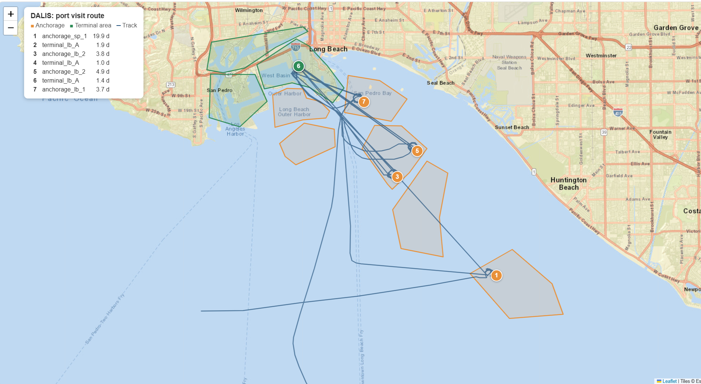

# San Pedro Bay Vessel Activity

An end-to-end analysis of public ship-tracking (AIS) data for the Ports of Los Angeles and Long Beach. The pipeline turns 10 million raw position reports into reconstructed port visits, measures how long ships wait and berth, and uses geofencing to show where each ship went, validated against the ships' own reported status.



## Key findings

- **Most ships don't wait.** Of 442 complete visits that reached a berth, the median wait before the first berth was **0 days** for both cargo ships and tankers. The averages were 0.5 days (cargo) and 1.0 day (tankers).
- **Long waits are rare outliers.** The longest wait in the dataset was the tanker **DALIS**: 19.8 days at anchor before its first berth.
- **Geofencing reveals full routes.** DALIS waited at an outer anchorage off Huntington Beach, then returned to the same Long Beach terminal area three times, moving to nearby anchorages between berth stops, before leaving after 37 days.
- **Two independent methods agree.** Durations from geofencing match the status-code analysis within a tenth of a day.

## Data

- **Source:** [NOAA / MarineCadastre.gov](https://marinecadastre.gov/ais) public AIS data, collected by the US Coast Guard
- **Area:** San Pedro Bay, including both ports and the offshore anchorages
- **Period:** January 1 to March 2, 2023
- **Volume:** 10,163,334 position reports from 1,614 vessels

Data files are not included in this repository because of their size. Download them with the AccessAIS tool on MarineCadastre.gov for the area and dates above, and save the export as `AIS_File_01.csv` in the project folder.

## Pipeline

| Step | Script | What it does |
|---|---|---|
| 1 | `explore_raw_data.py` | Profiles the raw file: date range, vessel counts, transmitter class, vessel types |
| 2 | `commercial_parquet.py` | Keeps cargo ships and tankers (AIS types 70 to 89) and saves them to Parquet |
| 3 | `build_events.py` | Splits each vessel's track into visits and clean phases (underway, anchored, moored), then computes visit metrics |
| 4 | `map_vessel.py` | Maps one vessel's track and prints its timeline (optional) |
| 5 | `export_points.py` | Exports stopped-ship positions to help draw zones in [geojson.io](https://geojson.io) |
| 6 | `geofence.py` | Labels every position by zone, rebuilds visits as zone-by-zone routes, and validates each zone |
| 7 | `show_route.py` | Builds the presentation map of a vessel's route |

`zones.geojson` contains the 9 zones used in this analysis (6 anchorages and 3 terminal areas).

### Run it

```
python -m venv venv
venv\Scripts\activate          # Windows (macOS/Linux: source venv/bin/activate)
pip install -r requirements.txt

python explore_raw_data.py
python commercial_parquet.py
python build_events.py
python geofence.py
python show_route.py
```

## How the data was cleaned

Raw AIS data is messy, and most of this project's work went into making it trustworthy.

- **Filtering noise.** About half of all vessels were recreational or small craft. Keeping only cargo ships and tankers cut the data from 10.2 million to 1.39 million rows (516 vessels) without losing any port traffic.
- **Time, not point counts.** Ships transmit at different rates depending on what they are doing, so durations are calculated from timestamps rather than by counting reports. Gaps over one hour are excluded so lost signal is not counted as time at anchor or at berth.
- **Status flicker.** Crew-entered navigation status briefly switches back and forth. Phases shorter than 30 minutes are dropped and repeated statuses are merged.
- **Separate visits.** A gap of more than 12 hours starts a new visit, since the ship likely left and returned.
- **Cut-off visits.** 80 visits were already in progress on January 1 or still ongoing on March 2. They are flagged and excluded from wait averages, because their true waits are unknown.

## Validation

Each zone was checked against the navigation status reported by the ships inside it:

| Zone type | % reporting "at anchor" | % reporting "moored" |
|---|---|---|
| 6 anchorage zones | 83% to 98% | 0% to 1% |
| 3 terminal areas | 0% | 89% to 93% |

This check caught an error during development: the anchorage and terminal labels had been swapped while drawing the zones. The status percentages exposed it immediately, and it was corrected before any results were shared.

## Results in numbers

| Measure | Value |
|---|---|
| Commercial vessels | 516 |
| Port visits | 736 |
| Visits that reached a berth | 500 |
| Zone stays (geofenced) | 1,127 |
| Busiest terminal area | Long Beach, 188 vessels |

### DALIS: full route

| Stop | Zone | Dates (2023) | Duration |
|---|---|---|---|
| 1 | Outer anchorage (off Huntington Beach) | Jan 2 to Jan 22 | 19.9 days |
| 2 | Long Beach terminal area | Jan 22 to Jan 24 | 1.9 days |
| 3 | Long Beach anchorage | Jan 24 to Jan 28 | 3.8 days |
| 4 | Long Beach terminal area | Jan 28 to Jan 29 | 1.0 day |
| 5 | Long Beach anchorage | Jan 29 to Feb 3 | 4.9 days |
| 6 | Long Beach terminal area | Feb 3 to Feb 5 | 1.4 days |
| 7 | Long Beach anchorage | Feb 5 to Feb 8 | 3.7 days |

## Limitations

- **Terminal zones are broad areas.** Each one likely covers several actual terminals, so "same terminal area" does not prove "same berth."
- **Only 3 terminal areas are mapped.** Visits that show only an anchorage may have berthed at an unmapped terminal, refueled, or waited for orders.
- **Two months of data.** Enough to describe patterns, but too short for seasonal analysis or reliable prediction.

## Tools

Python, DuckDB, pandas, Shapely, Folium, Parquet, GeoJSON

## Author

Jeffrey Arzu
